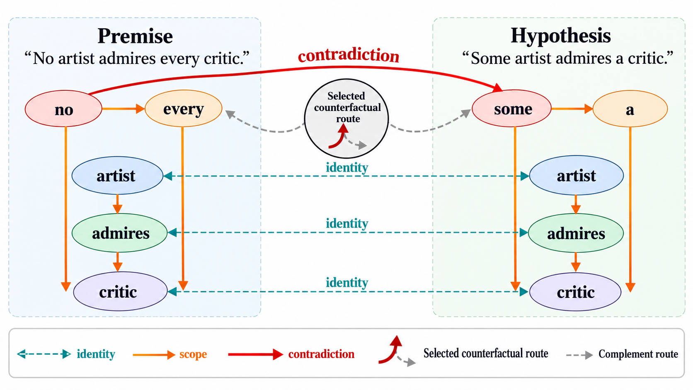

# DiGE-NLI v6 Architecture

DiGE-NLI v6 is **Counterfactual Multilingual Relation-Path Graph Composition**.
It extends v2's explicit text/graph feature composition with relation paths that
cross from premise to hypothesis and a counterfactual objective for selecting
the paths that support the NLI decision.

The v6a implementation is reproducible without a third-party knowledge-graph
API. It uses multilingual Transformer embeddings, Unicode-aware graph anchors,
typed diagnostic edges, and optional cached Wikidata features already supported
by the project. BabelNet is intentionally left as a future optional enrichment,
not a runtime dependency.



## Motivation

Experiment 009 showed a small AX-b MCC improvement for v2 over `pair_cls`, but
weaker mean performance across XNLI languages. The original graph builder used
an ASCII-only token pattern and English WordNet relations, which leaves weak
graph coverage for several XNLI scripts.

v6 addresses two separate questions:

1. Can a graph retain anchors and logic cues in non-English scripts?
2. Which cross-sentence relation paths are actually necessary for an NLI
   decision, rather than merely being present in the graph?

## High-Level Flow

```text
Premise + Hypothesis
        |
        +----------------------------+
        |                            |
        v                            v
Multilingual Transformer       Unicode-aware graph builder
        |                            |
        |                       typed graph edges
        |                            |
        |                            v
 h_pair, h_premise,        Relation-aware GAT nodes
 h_hypothesis                       |
        |                            v
        |                 Cross-sentence relation paths
        |                            |
        |                  route gates and counterfactual
        |                            |
        +------------ Feature Composition ------------+
                                      |
                         3-class NLI and binary heads
```

## Multilingual Graph Construction

The v6 graph builder upgrades anchor extraction for all future graph variants:

- Unicode letters are retained instead of only ASCII letters.
- Chinese character runs are represented as individual anchors until a dedicated
  segmenter is added.
- A compact multilingual negation lexicon detects frequent cues in the 15 XNLI
  languages.
- WordNet is used only for ASCII lexical pairs. Non-English pairs still obtain
  identity, number, scope, temporal, and contextual relation paths rather than
  being silently excluded.

Each node records both a diagnostic type and its side:

```text
node type: premise | hypothesis | negation | quantifier | number | ...
node side: premise | hypothesis
```

The side field permits v6 to distinguish local graph adjacency from an actual
premise-to-hypothesis reasoning route.

## Relation Paths

Let `z_i` be the contextual node embedding after the relation-aware GAT. For
each relation type `r`, v6 selects only cross-sentence edges:

```text
E_r = {(i, j): side(i) != side(j) and edge_type(i, j) = r}
```

It mean-pools source and target endpoints:

```text
s_r = mean({z_i : (i, j) in E_r})
t_r = mean({z_j : (i, j) in E_r})
```

and creates a route representation:

```text
p_r = MLP([s_r; t_r; |s_r - t_r|; s_r * t_r])
```

The path is therefore an encoded relation between the two sides, not merely a
histogram count or a pooled graph node. In addition to explicit graph edges,
v6 adds one virtual `semantic_alignment` route: every visible node proposes its
most similar node on the opposite sentence side using normalized contextual
mBERT node representations. The gate can suppress this candidate when the
alignment is unhelpful.

## Contextual Route Selection

Each route gets a gate conditioned on the full sentence-pair representation,
the route, and a learned relation embedding:

```text
g_r = sigmoid(MLP([h_pair; p_r; e_r]))
```

The selected evidence and its complement are:

```text
h_selected = sum(g_r * p_r) / sum(g_r)
h_complement = sum((1 - g_r) * p_r) / sum(1 - g_r)
```

Only relation types present in the graph can receive a nonzero gate. This gives
an inspectable relation-level explanation for each prediction.

## Feature Composition

v6 preserves v2's feature vector `phi_v2` and appends route contrasts:

```text
phi_v6 = [
  phi_v2;
  h_selected;
  h_complement;
  |h_selected - h_complement|;
  h_pair * h_selected;
  cos(h_pair, h_selected);
  cos(h_pair, h_complement);
  g
]
```

The main classifier predicts three-way NLI. The binary head and evidence-relation
head remain from v2 for AX-b alignment and diagnostic supervision.

## Counterfactual Route Objective

In addition to the v2 losses, v6 has two route losses. A shared route decision
head reads `h_pair` together with either selected or complementary routes.

```text
L_sufficiency = CE(RouteHead(h_pair, h_selected), y)
```

The selected route set must predict the gold NLI label. A margin loss then asks
the full model to assign a larger gold-label score than the complementary graph:

```text
L_necessity = max(0, m - (score_y(full) - score_y(complement)))
```

The implemented auxiliary objective is:

```text
L_aux = lambda * (L_binary + L_evidence + L_sufficiency + L_necessity + 0.01 * mean(g))
L_total = L_3 + L_aux
```

The small gate penalty favors concise explanations. This is a learned
counterfactual approximation: the model compares selected evidence with the
complement of selected routes without rebuilding the Transformer representation.

## Difference From Prior Versions

| Version | Main contribution | Limitation addressed by v6 |
|---|---|---|
| v2 | explicit text/graph feature composition | graph pooled globally |
| v3 | logic-scope pooled features | no cross-side path reasoning |
| v4 | optional Wikidata features | external evidence may be absent/noisy |
| v5 | relation-level GAT pooling | relation importance is not counterfactually trained |
| v6 | multilingual relation paths plus sufficiency/necessity selection | tests whether evidence supports the decision |

## Literature Inspiration

- KGNLI separates semantic and knowledge-relation representations before label
  prediction: [Wang, Li, and Zeng, 2020](https://aclanthology.org/2020.coling-main.571/).
- KGAnet adds relation importance to graph attention for NLI: [Song, Zhao, and
  HaiHong, 2020](https://link.springer.com/article/10.1007/s00521-020-04851-5).
- KGAT motivates evidence-focused attention rather than uniform graph pooling:
  [Liu et al., 2020](https://aclanthology.org/2020.acl-main.655/).
- Contextual relation-path representations motivate dynamic paths rather than
  fixed relation embeddings: [Wang et al., 2021](https://aclanthology.org/2021.conll-1.35/).
- BabelNet motivates the future optional multilingual KG enrichment because it
  connects lexicalizations through language-independent synsets: [Navigli and
  Ponzetto, 2012](https://www.sciencedirect.com/science/article/pii/S0004370212000793).

The combination implemented here is specific to DiGE: multilingual alignment
paths are treated as candidate evidence, then supervised by sufficiency and
necessity losses for the NLI decision. It should be described as a proposed
contribution until validated against graph-rationale baselines and multiple
seeds.

## Suggested Experiment

Use the exact protocol from experiment 009 and compare v2 and v6 before adding
other variants:

```bash
poetry run graphnli-train \
  --models pair_cls,dige_v2,dige_v6 \
  --seeds 42 \
  --training-protocol mnli \
  --train-limit 20000 \
  --batch-size 32 \
  --epochs 6 \
  --lr 2e-5 \
  --selection-metric nli3/macro_f1 \
  --patience 2 \
  --eval-languages all \
  --output-dir runs
```

For a first ablation, compare: v2; v6 without `L_necessity`; and full v6. The
primary outcomes are AX-b MCC, AX-b calibration, mean XNLI macro-F1, and mean
XNLI MCC. Report at least three seeds before interpreting small AX-b deltas.
