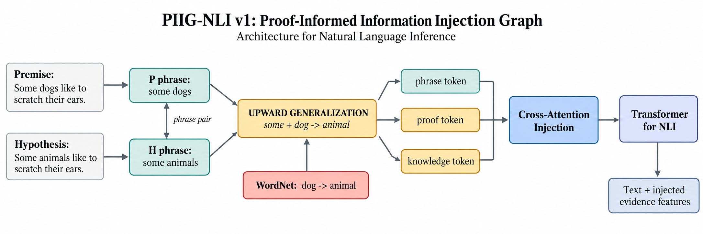

# PIIG-NLI v1 Architecture

PIIG-NLI v1 is **Proof-Informed Information Injection Graph** for NLI. It is a
separate architecture family from DiGE: instead of adding graph pools only at
the classifier, it turns graph evidence into tokens that are injected into the
Transformer's contextual states through cross-attention.



## Objective

AX-b contains small but decisive logical changes involving negation,
quantifiers, monotonicity, conjunction, disjunction, conditionals, time, and
numbers. A word graph alone exposes the ingredients but not the candidate
inference. PIIG makes candidate evidence paths first-class graph nodes.

## Graph Construction

Every example gets two phrase-anchor nodes:

```text
P: premise phrase: <key tokens from premise>
H: hypothesis phrase: <key tokens from hypothesis>
```

It then adds only available proof and knowledge nodes, up to 12 nodes total.

| Node family | Example | Source |
|---|---|---|
| Lexical bridge | `evidence lexical bridge across premise and hypothesis` | identity, synonymy, antonymy, hypernymy, or hyponymy in the text graph |
| Negation conflict | `evidence polarity contrast from negation scope` | negation occurs on only one side |
| Upward generalization | `evidence upward generalization through hyponym to hypernym` | a premise concept is a hyponym of a hypothesis concept; a local plural normalization recovers cases such as `dogs -> animals` |
| Conjunction elimination | `evidence conjunction elimination from premise structure` | premise contains conjunction plus an aligned bridge |
| Conditional direction | `evidence conditional direction requires an observed antecedent` | conditional operator on either side |
| External knowledge | `external knowledge: <cached Wikidata description/types>` | entity linker plus local Wikidata cache |
| Entity type path | `evidence entity type path from linked external knowledge` | a shared entity has cached type information |

The graph has typed edges: `phrase_pair`, `phrase_evidence`,
`phrase_knowledge`, and `evidence_knowledge`. This keeps Wikidata isolated
from a pair unless it is connected through a phrase anchor.

## Example

```text
P: Some dogs like to scratch their ears.
H: Some animals like to scratch their ears.

[P phrase] --phrase_pair--> [H phrase]
[P phrase] --phrase_evidence--> [upward generalization]
[H phrase] --phrase_evidence--> [upward generalization]

dog --WordNet:hyponym--> animal
some + dog -> animal + aligned predicate
```

The last line is represented as a candidate proof node, not as a hard-coded
entailment decision. The NLI head still learns whether that evidence supports
the label in context.

## Graph Encoding and Injection

Each graph node text is embedded using the input embedding layer of the same
multilingual Transformer. Node-type embeddings distinguish phrases, proof
types, and external facts. Two relation-aware graph-attention layers propagate
over the compact proof graph.

```text
proof nodes -> proof GAT -> proof tokens
textual hidden states -> cross-attention(query=text, key/value=proof tokens)
text states + attended proof features -> injected text states
```

There is no sigmoid fusion gate. The Transformer uses ordinary cross-attention
to decide which proof tokens are useful for each textual position.

## Final Feature Fusion

The classifier sees both factual text and graph-informed text:

```text
[h_pair,
 h_injected_CLS,
 h_proof_pool,
 |h_pair - h_injected_CLS|,
 h_pair * h_injected_CLS,
 h_proof_pool * h_injected_CLS,
 proof_node_type_counts]
```

This makes the injected evidence auditable while preserving a direct path from
the original pair representation.

## Training Objective

```text
L = CE_nli3 + aux_weight * (CE_binary + BCE_proof_types)
```

`BCE_proof_types` predicts the available proof categories from the pooled proof
graph. It is structural supervision derived from the constructed graph, not a
manually assigned explanation label.

## Wikidata Cache

PIIG never makes web calls while iterating a DataLoader. Build a local cache
before a knowledge-enabled run:

```bash
poetry run python scripts/build_wikidata_cache.py \
  --languages en \
  --max-examples 10000
```

Without a cache entry, the architecture still runs with phrase and logical
proof nodes; it simply has no factual Wikidata node for that entity.

## Evaluation Attribution Graph

Each `piig_v1` run saves the first deterministic AX-b example for every
available logical subtype by default:

```text
runs/experiment_XXX/piig_v1/seed_42/explanations/axb/negation.svg
runs/experiment_XXX/piig_v1/seed_42/explanations/axb/upward_monotone.svg
runs/experiment_XXX/piig_v1/seed_42/explanations/axb/index.json
```

The index maps every AX-b subtype to its selected UID and SVG. Each SVG is an
inspectable graph: node color and printed score represent the
normalized combination of mean text-to-proof cross-attention and mean
incoming/outgoing relation-aware GAT attention. Edge width and opacity show
the mean GAT attention across graph layers. The JSON keeps the exact node and
edge values, types, prediction, and AX-b label.

This is an attention attribution, not an optimization-based GNNExplainer
mask. It answers which constructed graph features the trained PIIG actually
used during injection, while adding one extra evaluation pass over the selected
split. Disable it with `--no-save-piig-explanations`
or choose another evaluation split with `--piig-explain-split xnli_test_en`.

## First Comparison

```bash
poetry run graphnli-train \
  --models pair_cls,dige_v8,piig_v1 \
  --seeds 42 \
  --model-name bert-base-multilingual-cased \
  --training-protocol mnli \
  --train-limit 20000 \
  --batch-size 24 \
  --epochs 6 \
  --lr 1e-5 \
  --selection-metric nli3/macro_f1 \
  --patience 2 \
  --eval-languages all \
  --output-dir runs
```

PIIG uses a cross-attention pass over up to 12 proof nodes, so batch size 24 is
a conservative starting point on Apple Silicon. The primary comparison is
AX-b binary MCC, followed by the logic-group scores, ECE, Brier score, and
multilingual XNLI average.
