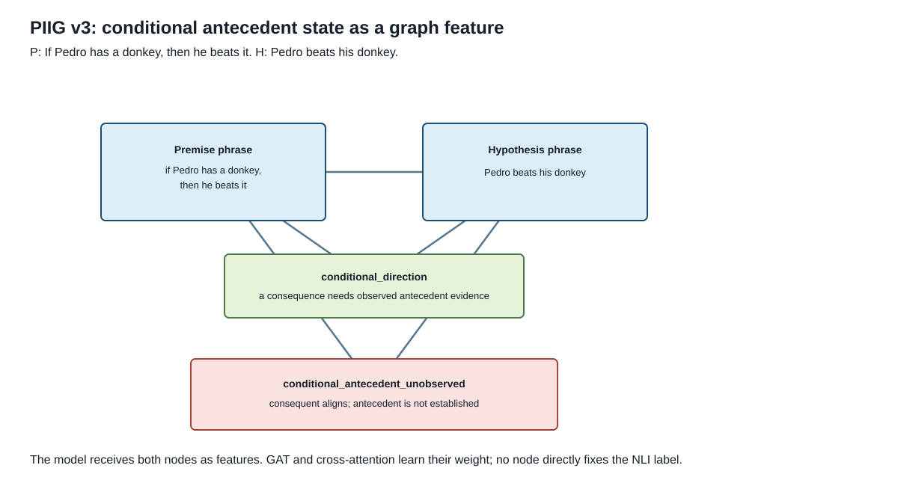

# PIIG-NLI v3 Architecture

PIIG-NLI v3 is a scope-conditioned extension of `piig_v1`. It keeps the same
compact proof graph, relation-aware GAT, cross-attention injection, and final
feature composition. The change is in graph construction: a lexical relation
or operator is not presented as a complete inference by itself. It is paired
with the logical context that determines whether that relation is valid.



## Motivation

Experiment 015 exposed three v1 failure modes:

1. A conditional-direction node existed, but could not say whether its
   antecedent was actually supported.
2. An upward-generalization node could be created inside a downward-sensitive
   quantifier context.
3. Disjunction had no dedicated proof node, leaving only lexical similarity.

v3 does not hard-code a label from these conditions. It materializes them as
typed graph features, and the Transformer plus GAT learns their composition.

## New Scope-Conditioned Nodes

| Node | Construction criterion | Meaning given to the model |
|---|---|---|
| `lexical_generalization_candidate` | cross-sentence hyponym/hypernym candidate | a lexical generalization exists, but its validity depends on context |
| `quantifier_polarity_context` | universal or downward-sensitive quantifier occurs | whether a quantifier creates a downward restrictor or an upward scope |
| `conditional_antecedent_observed` | a conditional consequent aligns and antecedent has strong lexical support | modus ponens is structurally available |
| `conditional_antecedent_unobserved` | consequent aligns but antecedent support is weak | affirming the consequent is not licensed |
| `disjunction_scope` | an `or`/`either`/`nor` construction occurs | an alternative is selected or remains unresolved; disjunction alone is not a branch assertion |

`conditional_direction` remains as a coarse operator node. The new antecedent
node supplies the missing state. Similarly, v3 replaces v1's
`upward_generalization` node with `lexical_generalization_candidate` and adds
the quantifier context when one is detected.

## Conditional Example

```text
P: If Pedro has a donkey, then he beats it.
H: Pedro beats his donkey.

[P phrase] ----- phrase_pair ------ [H phrase]
     |                                    |
     +-- conditional_direction -----------+
     +-- conditional_antecedent_unobserved+
     +-- lexical_bridge -------------------+

The consequent aligns, but "Pedro has a donkey" is not established.
```

The node does not force `not_entailment`. It gives cross-attention a feature
that distinguishes this case from one where the antecedent is present.

## Encoding and Loss

The encoder is unchanged from v1:

```text
typed proof nodes -> relation-aware proof GAT -> proof tokens
text hidden states -> cross-attention over proof tokens -> injected states
```

The final classifier receives the original pair representation, injected CLS,
pooled proof representation, their difference/product interactions, and proof
node-type counts. The auxiliary loss remains:

```text
L = CE_nli3 + aux_weight * (CE_binary + BCE_proof_types)
```

The new node types are additional graph-derived proof targets. They do not use
AX-b labels or logic-group metadata during training.

## First Comparison

```bash
poetry run graphnli-train \
  --models pair_cls,piig_v1,piig_v3 \
  --seeds 42 \
  --model-name bert-base-multilingual-cased \
  --training-protocol mnli \
  --train-limit 2000 \
  --batch-size 16 \
  --epochs 6 \
  --lr 1e-5 \
  --selection-metric nli3/macro_f1 \
  --patience 2 \
  --eval-languages en \
  --output-dir runs
```

The key slices to inspect are `Conditionals`, `Downward monotone`, and
`Disjunction`, plus AX-b MCC and calibration. Compare multiple seeds before
making a claim from the small diagnostic groups.
