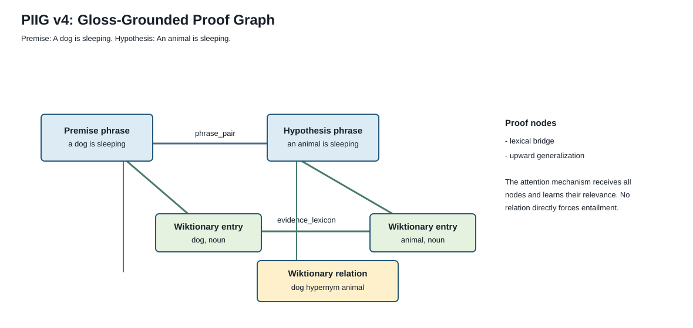

# PIIG-NLI v4 Architecture

PIIG-NLI v4 is a gloss-grounded extension of `piig_v1`. It retains the compact
proof graph, relation-aware GAT, cross-attention injection, and final feature
composition, but replaces Wikidata as its external source with a local,
task-oriented **English Wiktionary cache**.



## Motivation

Wikidata is useful for entity facts, but AX-b also contains lexical inference
problems where a definition or sense relation is more relevant than an
encyclopedic fact. v4 makes dictionary evidence available as graph tokens:

- short sense glosses;
- part of speech;
- explicit cached synonyms and antonyms;
- explicit cached hypernym and hyponym relations.

It does not convert a dictionary relation into an NLI label. The graph only
makes evidence available; the proof GAT and text-to-graph cross-attention learn
whether that evidence should matter for the sentence pair.

## Graph Construction

For content words that differ across the premise and hypothesis, v4 retrieves
at most `--max-wiktionary-entries` verified cache entries. Relation-bearing
pairs are prioritized, then remaining cached content words fill the budget.
The graph can include these typed nodes:

| Node | Meaning |
|---|---|
| `wiktionary_entry` | term, part of speech, and its primary cached sense |
| `wiktionary_gloss` | primary sense definition as a separate evidence token |
| `wiktionary_relation` | explicit synonym, antonym, hypernym, or hyponym pair across the two sentences |

They connect to each phrase anchor with `phrase_lexicon` edges and connect to
one another with `evidence_lexicon` edges. Existing logical proof nodes remain
available, so lexical evidence can be composed with negation, quantifier,
conditional, and conjunction evidence rather than replacing it.

```text
P: A dog is sleeping.
H: An animal is sleeping.

[premise phrase] ---- phrase_pair ---- [hypothesis phrase]
       |                                      |
       +-- phrase_lexicon -- [entry: dog] ----+
       +-- phrase_lexicon -- [gloss: domesticated canine]
       +-- evidence_lexicon - [dog hypernym animal]
       +-- phrase_lexicon -- [entry: animal]
```

The graph does not force entailment from `dog -> animal`: a downward-sensitive
quantifier or negation can still change the correct inference. The final model
decides from the contextual text state plus the attended graph representation.

## Cache Builder

The cache builder is resumable and is the only component that contacts
Wiktionary. Training and evaluation make no HTTP requests.

```bash
poetry run python scripts/build_wiktionary_cache.py \
  --sources mnli,axb,xnli \
  --languages en \
  --max-examples 10000 \
  --max-terms 4 \
  --sleep 0.10
```

It writes `data/cache/wiktionary_entries.jsonl`. Each verified row contains a
term, aliases, English senses, short glosses, part of speech, and any lexical
relations recovered from the source response. The default cache is English;
do not interpret it as multilingual lexical coverage for non-English XNLI.

The builder uses the Wiktionary REST definition endpoint and falls back to the
MediaWiki parse endpoint. If a network rejects the default identifier, pass a
descriptive value with `--user-agent`.

## Encoding and Objective

v4 uses the same injection mechanism as v1:

```text
typed proof nodes -> relation-aware proof GAT -> proof tokens
text hidden states -> cross-attention over proof tokens -> injected states
```

Its final representation is:

```text
[h_pair,
 h_injected_CLS,
 h_proof_pool,
 |h_pair - h_injected_CLS|,
 h_pair * h_injected_CLS,
 h_proof_pool * h_injected_CLS,
 proof_node_type_counts]
```

The training objective remains NLI cross entropy plus an auxiliary binary NLI
head and graph-derived proof-type supervision:

```text
L = CE_nli3 + aux_weight * (CE_binary + BCE_proof_types)
```

The three v4 proof targets are `wiktionary_entry_path`,
`wiktionary_gloss_path`, and `wiktionary_relation_path`. They indicate which
types of cached evidence were present; they are not hand-authored explanation
labels and do not use AX-b subtype metadata.

## Experiment

```bash
poetry run graphnli-train \
  --models pair_cls,piig_v1,piig_v4 \
  --seeds 42 \
  --model-name albert/albert-xxlarge-v2 \
  --training-protocol mnli \
  --train-limit 2000 \
  --batch-size 12 \
  --epochs 6 \
  --lr 1e-5 \
  --selection-metric nli3/macro_f1 \
  --patience 2 \
  --eval-languages en \
  --wiktionary-cache data/cache/wiktionary_entries.jsonl \
  --max-wiktionary-entries 2 \
  --device cuda \
  --output-dir runs
```

Run the cache builder before this comparison. Without a cache, v4 remains
runnable but becomes the logical PIIG graph without external lexical nodes;
that is a coverage failure, not a valid v4 comparison.

## Explanation Artifacts

v4 saves the normal first AX-b example for every logic subtype under:

```text
runs/experiment_XXX/piig_v4/seed_42/explanations/axb/
```

It also saves up to three examples that actually contain a `wiktionary_entry`,
`wiktionary_gloss`, or `wiktionary_relation` node:

```text
.../explanations/axb/wiktionary_examples/
|-- wiktionary_01_<logic>.svg
|-- wiktionary_01_<logic>.json
`-- index.json
```

These additional images make cache coverage inspectable. Node color and score
are attention attributions: normalized text-to-proof cross-attention combined
with relation-aware GAT attention. They show which available graph nodes the
trained model attended to, not a causal GNNExplainer mask.
